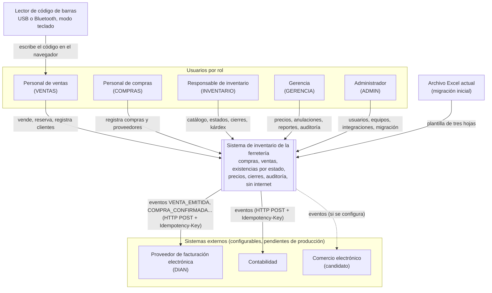
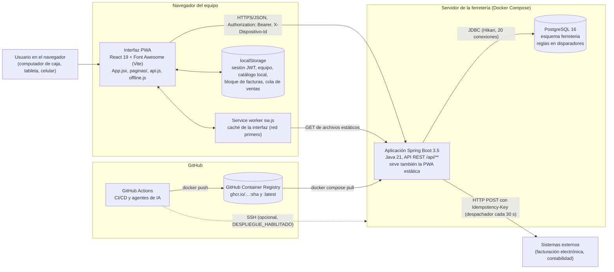
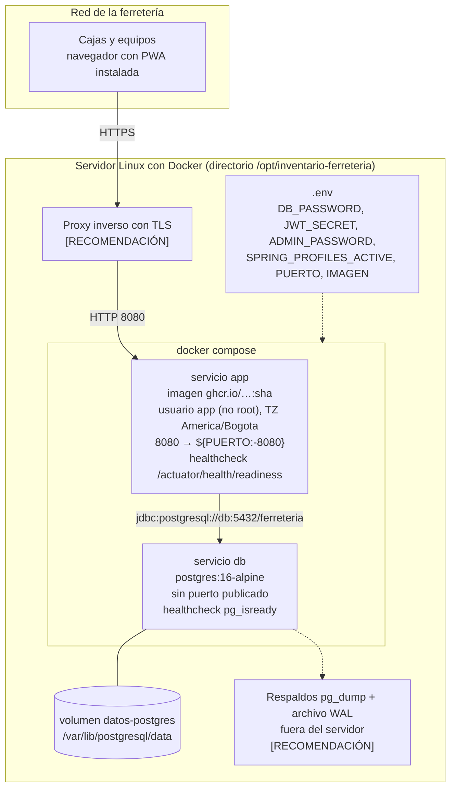
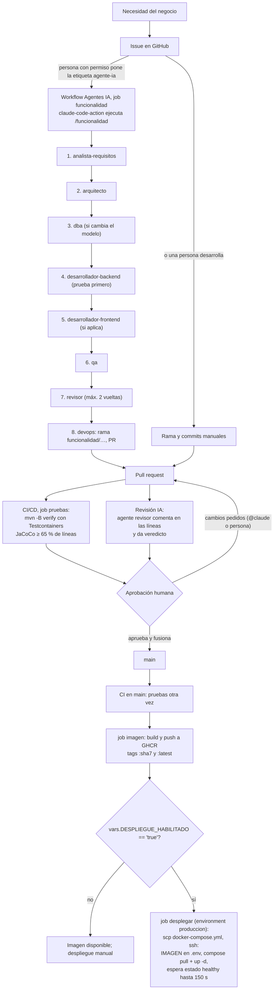

# Arquitectura — inventario de ferretería

**Estado:** versión 1.0 (13-oct-2026), alineada con el código de `inventario-ferreteria` (Spring Boot 3.5.16, Java 21,
PostgreSQL 16). **Referencias:** modelo C4 (Simon Brown) para las vistas; ISO/IEC 25010:2023 para los atributos de
calidad; formato ADR de Michael Nygard (Contexto / Decisión / Alternativas / Consecuencias).

**Convenciones:** lo que el repositorio ya hace se describe en presente y cita el archivo que lo implementa. Lo que es
una recomendación para producción y **no** está en el repositorio se marca **[RECOMENDACIÓN]**. Los límites conocidos
se marcan **[LIMITACIÓN]**.

Documentos relacionados: requisitos en [01-requisitos.md](01-requisitos.md); guía para agentes en
[`CLAUDE.md`](../CLAUDE.md). Los documentos 02 (análisis y diseño), 04 (base de datos), 05 (pruebas) y 06 (despliegue)
están referenciados por otros archivos del repositorio pero aún no existen (ver sección 9).

---

## 1. Objetivos y atributos de calidad

La arquitectura se decide por seis atributos de calidad tomados de la sección 7 de los requisitos. Para cada uno se
indican las tácticas usadas y dónde viven.

| Atributo | RNF | Objetivo medible | Tácticas aplicadas | Dónde |
|---|---|---|---|---|
| Seguridad (acceso) | RNF-SEG-001 | Matriz de permisos superada al 100 % | Autenticación con contraseña BCrypt y token JWT HS256 sin estado; permisos (no roles) dentro del token; `@PreAuthorize` por endpoint; costos ocultos sin `COSTO_VER` | `seguridad/ConfiguracionSeguridad`, `AutenticacionController`, controladores, `CatalogoConsultas`, `SeguridadTest` |
| Auditoría | RNF-SEG-002 | 100 % de movimientos auditados; auditoría no modificable; 5 años | Disparador genérico `fn_auditar` sobre 21 tablas de negocio; contexto de usuario, equipo y origen por transacción (`set_config`); tablas de solo inserción (`fn_inmutable`); particiones mensuales | `V1__esquema_inventario.sql` §11–12, `comun/ContextoAuditoria` |
| Rendimiento con volumen alto | RNF-REN-001 | Código de barras < 300 ms p95; venta de 20 líneas < 2 s p95; 20.000 movimientos/día | SQL directo con `JdbcClient` en la ruta caliente; saldos materializados en `existencia` (no se suma el kárdex para consultar); índices por FK y fecha; particionado mensual de `movimiento` y `auditoria`; pool Hikari de 20 conexiones; bloqueo por referencia (`FOR UPDATE`) en lugar de bloqueo de tabla | `inventario/Kardex`, `V1` §8 y §12.3, `application.yml` |
| Fiabilidad | RNF-FIA-001, RNF-REC-001 | Ningún documento sin movimientos ni movimientos sin documento; RPO ≤ 15 min, RTO ≤ 4 h | Una transacción por operación de negocio (`@Transactional` en servicios); reglas críticas en disparadores (última defensa); idempotencia por `uuid`; outbox transaccional; contenedores con `healthcheck` y `restart: unless-stopped`; respaldos **[RECOMENDACIÓN]** (sección 5) | Servicios, `V1` §12, `integracion/`, `docker-compose.yml` |
| Operación sin internet | RNF-COM-001, RF-OFF-001 | 8 h sin conexión, sin duplicados al sincronizar | PWA con *service worker* (interfaz en caché); copia local del catálogo y cola de ventas en `localStorage`; bloques de numeración por equipo; UUID generado en el equipo; revalidación en el servidor y estado `CONFLICTO` | `frontend/public/sw.js`, `frontend/src/offline.js`, `sincronizacion/`, `inventario/Consecutivos` |
| Mantenibilidad | RNF-MAN-001 | ≥ 3 particiones futuras siempre | Monolito modular por paquete de negocio; migraciones Flyway inmutables (protegidas por *hook*); `fn_crear_particiones` al arrancar y cada mes (7 meses adelante); CI con pruebas sobre PostgreSQL real y cobertura mínima de 65 %; reglas de trabajo en `CLAUDE.md` y agentes especializados | `cierres/TareasCierre`, `pom.xml` (JaCoCo), `.claude/`, `.github/workflows/` |

Atributos secundarios: **capacidad de interacción** (RNF-INT-001: lector de código tipo teclado, sin controladores) y
**compatibilidad** con sistemas externos (RF-INT-001: HTTP + JSON con cabecera `Idempotency-Key`).

---

## 2. Vista C4 nivel 1: contexto

El sistema es una sola aplicación web usada en el mostrador, la bodega y la oficina de una ferretería con una sola
bodega. Los lectores de código de barras se comportan como un teclado (escriben el código y Enter), así que no hay
integración de hardware.

Notas:
- La **recepción** de datos desde sistemas externos (dirección `ENTRADA`, tabla `mapeo_externo`) está modelada en la
  base de datos pero **no tiene código** todavía **[LIMITACIÓN]**: hoy la integración es solo de salida.
- La factura la numera, guarda e imprime el sistema; la validación ante la DIAN la hace el proveedor externo a partir
  del evento (sección 9 de los requisitos).

---

## 3. Vista C4 nivel 2: contenedores

| Contenedor | Tecnología | Responsabilidad | Archivo |
|---|---|---|---|
| Interfaz PWA | React 19, Vite, Font Awesome; compilada por Maven a `static/` | Pantallas por permiso; venta con lector; trabajo sin internet | `frontend/` |
| Service worker | Cache API, estrategia *red primero* | Abrir la interfaz sin conexión; **nunca** guarda respuestas de `/api/` | `frontend/public/sw.js` |
| Almacenamiento local | `localStorage` | Sesión, equipo elegido, copia del catálogo (hasta 500 referencias), bloque de facturas y cola de ventas | `frontend/src/api.js`, `frontend/src/offline.js` |
| Aplicación | Spring Boot 3.5.16, Spring MVC, Security, Data JPA, JdbcClient, Actuator, springdoc | API REST, reglas de aplicación, tareas programadas, despacho de eventos | `src/main/java/...` |
| Base de datos | PostgreSQL 16 (imagen `postgres:16-alpine`) | Datos, reglas críticas, auditoría, particiones | `db/migration/V1`, `V2` |
| Registro de imágenes | GHCR | Imagen versionada por SHA corto y `latest` | `.github/workflows/ci.yml` |

---

## 4. Vista C4 nivel 3: componentes de la aplicación

La aplicación es un **monolito modular**: un paquete por módulo de negocio con controlador delgado, servicio
`@Transactional` y consultas SQL. Las flechas muestran dependencias de compilación reales (imports entre paquetes).

```mermaid
flowchart TB
    subgraph Web["Entrada HTTP"]
        SEC["Cadena de seguridad<br/>OAuth2 Resource Server (JWT HS256)<br/>@EnableMethodSecurity"]
        ERR["ManejadorErrores<br/>@RestControllerAdvice → ProblemDetail"]
    end

    subgraph Negocio["Módulos de negocio (co.ferreteria.inventario.*)"]
        CAT["catalogo<br/>productos, referencias, conversiones<br/>(JPA + CatalogoConsultas)"]
        TER["terceros<br/>clientes y proveedores, DV del NIT<br/>(JPA)"]
        COM["compras<br/>documento de ingreso, anulación"]
        VEN["ventas<br/>factura, anulación"]
        INV["inventario<br/>Kardex, Consecutivos, EstadoService,<br/>InfoReferencias"]
        PRE["precios<br/>porcentaje, precio manual, historial"]
        CIE["cierres<br/>cierre y reapertura mensual"]
        SYN["sincronizacion<br/>bloques, cola sin internet, conflictos"]
        MIG["migracion<br/>Excel (Apache POI)"]
        REP["reportes"]
        AUD["auditoria<br/>consulta"]
        INT["integracion<br/>BandejaSalida, DespachadorEventos"]
        SEG["seguridad<br/>usuarios, roles, login, UsuarioActual"]
    end

    subgraph Transversal["Transversales"]
        CTX["ContextoAuditoria<br/>aspecto @Before en @Service:<br/>set_config(app.usuario_id, app.dispositivo_id, app.origen)"]
        FEC["comun: Fechas (America/Bogota),<br/>Cantidades, JsonPostgres, excepciones"]
        TAR["Tareas programadas<br/>TareasCierre (cron día 1 02:00),<br/>TareasInventario (reservas, 15 min),<br/>DespachadorEventos (30 s)"]
    end

    DB[("PostgreSQL<br/>disparadores: fn_aplicar_movimiento,<br/>fn_auditar, fn_inmutable, fn_cerrar_periodo")]

    SEC --> Negocio
    VEN --> INV
    VEN --> INT
    COM --> INV
    COM --> INT
    SYN --> VEN
    SYN --> INV
    SYN --> CAT
    MIG --> CAT
    MIG --> TER
    MIG --> INV
    CIE --> INV
    Negocio --> FEC
    Negocio --> SEG
    CTX -. "antes de cada servicio transaccional" .-> Negocio
    TAR --> CIE
    TAR --> INV
    TAR --> INT
    Negocio --> DB
    CTX --> DB
```

Componentes clave:

| Componente | Responsabilidad | Detalle relevante |
|---|---|---|
| `inventario.Kardex` | **Único** punto de escritura del kárdex (`INSERT INTO movimiento`) | El disparador `fn_aplicar_movimiento` valida período, lote y vencimiento, bloquea la referencia, actualiza `existencia` (con `CHECK cantidad >= 0`) y recalcula el costo promedio ponderado en la misma transacción. |
| `inventario.Consecutivos` | Numeración de ingresos y facturas | `UPDATE … RETURNING` bloquea la fila: sin repetidos ni huecos por concurrencia. Reserva bloques por equipo para trabajar sin internet. |
| `comun.ContextoAuditoria` | Contexto de auditoría por transacción | `@EnableTransactionManagement(order = 0)` en `InventarioApplication` abre la transacción **antes** del aspecto (`@Order(10)`), así `set_config(..., true)` queda local a esa transacción y no se filtra a otra petición que reutilice la conexión del pool. |
| `comun.ManejadorErrores` | Traducción de errores | `NegocioException` → 422; `NoEncontradoException` → 404; validación → 400; `AccessDeniedException` → 403; SQLSTATE `23505` → 409, `23514/23503/23502` → 409, `P0001` (`RAISE EXCEPTION`) → 422. |
| `integracion.BandejaSalida` | Outbox | Inserta un evento por sistema externo activo con URL, en la transacción del documento. |
| `integracion.DespachadorEventos` | Envío con reintentos | Toma hasta 50 pendientes con `FOR UPDATE SKIP LOCKED`, envía `POST` con `Idempotency-Key`, reintenta a los 2^n minutos y pasa a `ERROR` tras 8 intentos (`app.integracion.max-intentos`). |
| `sincronizacion.SincronizacionService` | Aplicar ventas hechas sin internet | Cada operación en su propia transacción (`REQUIRES_NEW`); si ya existe el `uuid`, devuelve el resultado anterior; si una regla falla, la guarda en `CONFLICTO`. |
| `cierres.TareasCierre` | Cierre programado y particiones | Al arrancar y cada mes crea particiones de `movimiento` y `auditoria` para el mes actual y 6 siguientes; el día 1 a las 02:00 (America/Bogota) cierra el mes anterior. |
| `inventario.TareasInventario` | Liberar reservas vencidas (72 h) | Corre cada 15 min; define `ComoSistema`, que ejecuta tareas con `uid = 1`. |

**Acceso a datos.** JPA (Hibernate, `ddl-auto: validate`, `open-in-view: false`) se usa para maestros con pocas
reglas: `Usuario`, `Rol`, `Producto`, `Referencia`, `Categoria`, `Marca`, `Tercero`. `JdbcClient` con bloques de texto
se usa para documentos (compra, venta), kárdex, existencias, cierres, reportes, sincronización e integración.

---

## 5. Vista de despliegue

**Lo que está en el repositorio:**

| Elemento | Valor | Archivo |
|---|---|---|
| Imagen | Multietapa: `maven:3.9.11-eclipse-temurin-21` compila; `eclipse-temurin:21-jre-alpine` ejecuta las capas del jar (`jarmode=tools extract --layers`) con `JarLauncher` | `Dockerfile` |
| Usuario | `app` sin privilegios | `Dockerfile` |
| Memoria | `-XX:MaxRAMPercentage=75` | `Dockerfile` |
| Salud | `HEALTHCHECK` contra `/actuator/health/readiness` (sondas activadas en `application.yml`); `depends_on: condition: service_healthy` para la base | `Dockerfile`, `docker-compose.yml` |
| Persistencia | Volumen con nombre `datos-postgres` | `docker-compose.yml` |
| Puertos | Solo la aplicación se publica (`${PUERTO:-8080}:8080`); PostgreSQL queda en la red interna de Compose | `docker-compose.yml` |
| Variables obligatorias | `DB_PASSWORD` y `JWT_SECRET` (Compose falla si faltan; la app exige ≥ 32 bytes para el secreto) | `docker-compose.yml`, `ConfiguracionSeguridad` |
| Primer arranque | Si no hay usuarios y `ADMIN_PASSWORD` tiene ≥ 8 caracteres, se crea `admin` | `seguridad/ArranqueAdministrador` |
| Perfiles | `default` (base vacía) o `demo` (agrega `db/demo/V100__datos_demo.sql`, con equipo `CAJA-01` y rango `FC1` 1–5.000) | `application.yml` |
| Zona horaria | `TZ=America/Bogota` en ambos contenedores; `SET TIME ZONE 'America/Bogota'` en cada conexión; Hibernate en UTC | `docker-compose.yml`, `application.yml` |

**Recomendaciones para cumplir RNF-REC-001 (RPO ≤ 15 min, RTO ≤ 4 h) [RECOMENDACIÓN]:**

1. **Respaldo base diario** con `pg_dump -Fc` (o `pg_basebackup`) ejecutado desde el host contra el contenedor `db`,
   copiado fuera del servidor (otro equipo o almacenamiento en la nube) y conservado según la política de la empresa.
2. **RPO de 15 minutos:** un `pg_dump` diario no lo cumple. Hace falta archivo continuo de WAL (`archive_mode = on`,
   `archive_timeout = 300` o menos, con una herramienta como pgBackRest o WAL-G) para recuperación a un punto en el
   tiempo. Esto exige montar configuración adicional de PostgreSQL que hoy no está en `docker-compose.yml`.
3. **Prueba de restauración trimestral** (criterio de RNF-REC-001) sobre un servidor limpio, midiendo el RTO real.
4. **TLS**: Compose publica HTTP plano en el puerto 8080. Los tokens viajan en la cabecera `Authorization`, así que en
   producción debe ir detrás de un proxy inverso con HTTPS (Caddy, Nginx o Traefik). Además, los *service workers*
   solo se registran en HTTPS o en `localhost`: sin TLS la operación sin internet no funciona en las cajas.
5. **No usar `docker compose down -v`** (borra el volumen); `.claude/settings.json` ya lo prohíbe a los agentes.
6. **Acceso a GHCR**: si el paquete de la imagen es privado, el servidor necesita `docker login ghcr.io` con un token de
   solo lectura antes del primer `docker compose pull`; el flujo de despliegue no lo hace.

---

## 6. Vista de flujo de entrega (CI/CD con agentes de IA)

Piezas de la cadena:

| Pieza | Qué hace | Archivo |
|---|---|---|
| CI/CD | `pruebas` en cada PR, push a `main` y ejecución manual; `imagen` y `desplegar` solo en push a `main`; `concurrency` cancela ejecuciones viejas de la misma rama | `.github/workflows/ci.yml` |
| Asistente | Responde a comentarios que mencionan `@claude` en issues y PR (hasta 40 turnos) | `.github/workflows/claude.yml` (job `asistente`) |
| Agente de funcionalidad | Al etiquetar un issue con `agente-ia`, corre `/funcionalidad` (hasta 150 turnos, 90 min) y comenta el enlace del PR | `.github/workflows/claude.yml` (job `funcionalidad`), `.claude/commands/funcionalidad.md` |
| Revisión IA | En PR abiertos o actualizados (no borrador), actúa como `revisor` con herramientas de solo lectura más comentarios en el PR | `.github/workflows/revision-ia.yml`, `.claude/agents/revisor.md` |
| Subagentes | Ocho roles: analista, arquitecto, DBA, backend, frontend, QA, revisor, devops | `.claude/agents/*.md` |
| Barandas locales | Permisos permitidos y prohibidos (no leer `.env`, no `git push --force`, no `docker compose down -v`); *hook* `PreToolUse` que bloquea editar migraciones versionadas | `.claude/settings.json`, `.claude/hooks/proteger-migraciones.sh` |

---

## 7. Decisiones de arquitectura (ADR)

Estado de todas: **Aceptada** (13-oct-2026) salvo que se indique otra cosa. Un cambio de decisión se registra como un
ADR nuevo que reemplaza al anterior; no se edita el histórico.

### ADR-001 — Monolito modular en lugar de microservicios

- **Contexto:** una ferretería, una bodega, equipo de desarrollo pequeño, 30 usuarios simultáneos estimados. Compra,
  venta, kárdex y cierre comparten el mismo saldo y deben ser atómicos (RNF-FIA-001).
- **Decisión:** una sola aplicación Spring Boot desplegable, organizada en paquetes por módulo de negocio
  (`catalogo`, `compras`, `ventas`, `inventario`, …) y una sola base PostgreSQL.
- **Alternativas consideradas:** microservicios por dominio (inventario, ventas, compras) con mensajería; monolito en
  capas técnicas (`controllers`, `services`, `repositories`).
- **Consecuencias:** (+) transacciones ACID locales entre documento y kárdex, sin sagas; un solo despliegue; pruebas
  de integración simples. (−) los límites entre módulos no los impone el compilador (no se usa Spring Modulith ni
  ArchUnit) y ya existe un ciclo `comun` ↔ `seguridad`; escalar es vertical o con varias réplicas de la misma imagen.

### ADR-002 — PostgreSQL con reglas críticas en disparadores

- **Contexto:** las reglas «sin saldos negativos», «mes cerrado no admite movimientos», «no vender lotes vencidos»,
  «costo promedio» y «auditoría» no pueden depender de que todo camino de código las recuerde (migración, sincronización,
  scripts manuales, agentes de IA).
- **Decisión:** PostgreSQL 16 es la última defensa: `CHECK`, `UNIQUE`, FK y los disparadores `fn_aplicar_movimiento`,
  `fn_inmutable`, `fn_auditar` y la función `fn_cerrar_periodo`. Java valida antes solo para dar mejores mensajes.
- **Alternativas consideradas:** reglas solo en Java (servicios de dominio); base documental o MySQL.
- **Consecuencias:** (+) imposible romper un saldo desde cualquier cliente SQL que use el esquema; concurrencia
  resuelta con bloqueo de fila por referencia. (−) lógica en PL/pgSQL, menos visible y más difícil de depurar; los
  errores llegan como `PSQLException` y hay que traducirlos (`ManejadorErrores`); acoplamiento a PostgreSQL.

### ADR-003 — JPA para maestros y JdbcClient para documentos y kárdex

- **Contexto:** los maestros son CRUD simples; los documentos y el kárdex necesitan SQL preciso (enums de PostgreSQL,
  `RETURNING`, `FOR UPDATE SKIP LOCKED`, `jsonb`, tablas particionadas, valores calculados por disparadores).
- **Decisión:** Spring Data JPA (`ddl-auto: validate`) para `Usuario`, `Rol`, `Producto`, `Referencia`, `Categoria`,
  `Marca` y `Tercero`; `JdbcClient` con bloques de texto para todo lo demás.
- **Alternativas consideradas:** solo JPA; solo JDBC; jOOQ; MyBatis.
- **Consecuencias:** (+) SQL explícito y rápido en la ruta caliente; sin problemas de caché de primer nivel frente a
  cambios hechos por disparadores. (−) dos estilos de acceso a datos; el esquema se valida contra las entidades solo
  para las tablas JPA; las consultas `JdbcClient` solo se validan por pruebas de integración.

### ADR-004 — Kárdex inmutable y particionado por mes

- **Contexto:** 20.000 movimientos diarios y 5 años en línea (≈ 36 millones de filas); el kárdex es la prueba de cada
  cambio de existencias (RN-02, RN-06).
- **Decisión:** tabla `movimiento` particionada por rango de `fecha_efectiva` (una partición por mes, más
  `movimiento_default` como red de seguridad); `UPDATE` y `DELETE` rechazados por `fn_inmutable`; correcciones solo
  por movimientos de anulación con `reversa_movimiento_id`. Los saldos se mantienen materializados en `existencia`.
- **Alternativas consideradas:** tabla única con índices; recalcular saldos sumando el kárdex; permitir edición con
  historial.
- **Consecuencias:** (+) consultas por mes con poda de particiones; archivado futuro por partición; trazabilidad
  completa. (−) la clave primaria y el `UNIQUE (sync_uuid, fecha_efectiva)` deben incluir la columna de partición, así
  que la unicidad global de `sync_uuid` no la garantiza la base (la idempotencia real está en `venta.uuid` y
  `compra.uuid`); las particiones dependen de una tarea programada.

### ADR-005 — JWT sin estado con permisos en el token

- **Contexto:** API consumida por una PWA que debe seguir abierta con red intermitente; un solo servidor; no hay
  proveedor de identidad corporativo.
- **Decisión:** `POST /api/auth/login` valida la contraseña (BCrypt) y emite un JWT HS256 firmado con `JWT_SECRET`
  (validez 10 h, `app.jwt.horas-validez`) con los claims `sub`, `uid`, `nombre` y `permisos`. Spring Security actúa como
  *resource server*: convierte `permisos` en autoridades sin prefijo y `@PreAuthorize` las exige.
- **Alternativas consideradas:** sesión con cookie y CSRF; OAuth2/OIDC con Keycloak; JWT RS256 con par de claves.
- **Consecuencias:** (+) sin estado en el servidor; autorización sin consultar la base en cada petición; simple de
  operar. (−) un cambio de permisos o la desactivación de un usuario no surte efecto hasta que vence el token (hasta
  10 h); no hay revocación ni *refresh token*; un único secreto compartido firma y verifica (ver sección 8).

### ADR-006 — Auditoría por disparador con contexto de sesión (`set_config`)

- **Contexto:** RNF-SEG-002 exige auditar el 100 % de los cambios, incluidos los que llegan por sincronización,
  migración o funciones SQL, con usuario, equipo y origen.
- **Decisión:** disparador `AFTER INSERT OR UPDATE OR DELETE` (`fn_auditar`) en 21 tablas de negocio que guarda
  `antes` y `despues` en JSONB. El aspecto `ContextoAuditoria` fija `app.usuario_id`, `app.dispositivo_id` y
  `app.origen` con `set_config(..., true)` (alcance de transacción) antes de cada método de un `@Service`. La tabla
  `auditoria` es de solo inserción y está particionada por mes.
- **Alternativas consideradas:** Hibernate Envers; auditoría en Java (eventos de aplicación); extensión `pgaudit`.
- **Consecuencias:** (+) cubre también los cambios hechos por disparadores y SQL directo; un solo mecanismo. (−) el
  usuario queda registrado solo si la transacción pasa por un `@Service` o por un controlador marcado `@Transactional`
  (el aspecto cubre ambos); el inicio de sesión, que aún no tiene usuario autenticado, registra `ultimo_acceso` sin
  autor; `fn_auditar` excluye la columna `hash_contrasena`; toda tabla nueva debe agregarse a la lista (regla 3 de
  `CLAUDE.md`).

### ADR-007 — Outbox transaccional para integración, con idempotencia y reintentos

- **Contexto:** RF-INT-001 exige que una caída del sistema externo no impida vender y que un evento repetido no se
  aplique dos veces.
- **Decisión:** `BandejaSalida` inserta en `evento_integracion` en la misma transacción del documento (si la venta se
  revierte, no hay evento). `DespachadorEventos` lo envía cada 30 s con `Idempotency-Key = clave_idempotencia`,
  reintenta con espera 2^n minutos y deja el evento en `ERROR` tras 8 intentos; el administrador puede reintentarlo por
  `POST /api/integracion/eventos/{id}/reintentar`.
- **Alternativas consideradas:** llamada HTTP síncrona dentro de la venta; *broker* de mensajes (RabbitMQ, Kafka);
  CDC con Debezium.
- **Consecuencias:** (+) consistencia sin transacciones distribuidas; entrega al menos una vez; `SKIP LOCKED` permite
  varias instancias. (−) el receptor debe respetar `Idempotency-Key`; el envío HTTP ocurre dentro de la transacción del
  lote y `RestClient` no tiene tiempos de espera configurados (sección 9); el «aviso al administrador» de RF-INT-001 es
  hoy solo el estado `ERROR` consultable y el log.

### ADR-008 — Operación sin internet con bloques de numeración y UUID

- **Contexto:** RF-OFF-001: vender sin conexión hasta 8 h, sin facturas duplicadas y sin saldos negativos al volver.
- **Decisión:** cada equipo autorizado (`dispositivo.permite_fuera_linea`) pide un bloque de números de factura de su
  propio rango (`consecutivo` con `dispositivo_id`, p. ej. `FC1`). La PWA guarda una copia del catálogo, valida contra
  ella, numera con su bloque y encola la venta con un UUID propio. Al reconectar, `POST /api/sync/ventas` aplica cada
  operación una vez (`operacion_fuera_linea.uuid` es clave primaria), revalida en la base y deja en `CONFLICTO` lo que
  incumple una regla. El cierre de mes se rechaza si hay operaciones `RECIBIDA` o `CONFLICTO` del período.
- **Alternativas consideradas:** base local en cada caja con replicación (SQLite/PouchDB-CouchDB); bloquear la venta sin
  red; numeración provisional renumerada al sincronizar.
- **Consecuencias:** (+) sin colisiones de numeración ni duplicados; el servidor sigue siendo la fuente de verdad.
  (−) solo **ventas** funcionan sin internet (compra, reserva y registro de cliente, previstos en RF-OFF-001, no);
  la copia local trae como máximo 500 referencias; el UUID es v4 (`crypto.randomUUID`), no v7 como dice RF-OFF-001;
  los conflictos solo se pueden rechazar, no reaplicar; cada equipo y su rango se crean hoy por SQL.

### ADR-009 — PWA en JavaScript sin framework, servida por Spring Boot (reemplazada por ADR-015)

- **Contexto:** interfaz de mostrador sencilla, mantenida por un equipo pequeño y por agentes de IA; debe abrirse sin
  internet y funcionar en celular.
- **Decisión:** HTML, CSS y módulos ES (`api.js`, `offline.js`, `vistas.js`, `app.js`) en `src/main/resources/static`,
  sin paso de compilación, servidos por la misma aplicación; `manifest.webmanifest` y `sw.js` la hacen instalable.
- **Alternativas consideradas:** React/Vue/Angular con su propia cadena de compilación; aplicación de escritorio.
- **Consecuencias:** (+) un solo artefacto y un solo origen (sin CORS); cero dependencias de npm. (−) sin componentes
  ni tipado; el escape de HTML depende de usar siempre `esc()`; no hay pruebas automáticas de la interfaz en CI.

### ADR-010 — Flyway con migraciones inmutables protegidas por *hook*

- **Contexto:** Flyway guarda el *checksum* de cada migración aplicada; editar una ya desplegada rompe el arranque en
  todas las bases existentes. Los agentes de IA editan archivos con facilidad.
- **Decisión:** todo cambio de esquema es un `V{n+1}__descripcion.sql` nuevo. El *hook* `PreToolUse`
  `proteger-migraciones.sh` rechaza (código 2) cualquier `Edit`/`Write` de Claude Code sobre un `V*__*.sql` ya versionado
  en git. Hibernate solo valida (`ddl-auto: validate`).
- **Alternativas consideradas:** Liquibase; `ddl-auto: update`; confiar solo en la revisión.
- **Consecuencias:** (+) historia del esquema reproducible; protección automática frente a agentes. (−) el *hook* no
  protege de ediciones humanas (para eso está la validación de Flyway al arrancar y la revisión del PR); las
  migraciones de datos demo (`V100`) comparten numeración con las reales en el perfil `demo`.

### ADR-011 — Despliegue en contenedores con Docker Compose e imágenes en GHCR

- **Contexto:** un servidor en la ferretería o en la nube, sin equipo de operaciones; RTO ≤ 4 h.
- **Decisión:** imagen multietapa por capas, usuario sin privilegios y `HEALTHCHECK`; `docker-compose.yml` con
  `postgres:16-alpine` y la app; CI publica en GHCR con etiqueta por SHA corto y `latest`; despliegue opcional por SSH
  activado con la variable `DESPLIEGUE_HABILITADO`.
- **Alternativas consideradas:** Kubernetes; PaaS (Heroku, Render, Railway); jar con systemd.
- **Consecuencias:** (+) mismo artefacto en pruebas y producción; reversión cambiando `IMAGEN` en `.env`; arranque con
  un comando. (−) un solo nodo (sin alta disponibilidad); respaldos, TLS y monitoreo quedan fuera del repositorio
  (sección 5).

### ADR-012 — Agentes de IA con humano en el circuito

- **Contexto:** se quiere acelerar el desarrollo con agentes que escriben requisitos, código, pruebas y PR, sin perder
  el control sobre lo que llega a producción.
- **Decisión:** `CLAUDE.md` fija reglas no negociables; ocho subagentes con herramientas acotadas (el revisor no puede
  editar); el comando `/funcionalidad` encadena los roles; el agente **nunca fusiona**: abre el PR, CI y la revisión IA
  lo evalúan y una persona aprueba. Solo quien puede etiquetar issues dispara el agente de funcionalidad.
- **Alternativas consideradas:** desarrollo sin agentes; agentes con permiso de fusión automática.
- **Consecuencias:** (+) proceso repetible y trazable (issue → PR con requisitos y pruebas). (−) la aprobación humana
  obligatoria y el *status check* de CI dependen de reglas de protección de `main` configuradas en GitHub, que **no
  están versionadas** en el repositorio **[RECOMENDACIÓN: activarlas]**; consumo de la API de Anthropic; los resultados
  del agente requieren revisión crítica igual que los de una persona.

### ADR-013 — Spring Boot 3.5 con ruta documentada hacia Spring Boot 4

- **Contexto:** Spring Boot 3.5 es la última línea 3.x (Spring Framework 6.2, Jakarta EE 10, Jackson 2). Ya existe la
  línea 4.x, basada en Spring Framework 7. Migrar durante el proyecto académico añade riesgo sin beneficio funcional.
- **Decisión:** mantener Spring Boot **3.5.16** con Java 21 y planear la migración a 4.x como trabajo separado,
  revisando antes las fechas de soporte publicadas por el proyecto Spring (no se fijan aquí).
- **Alternativas consideradas:** iniciar en Spring Boot 4; quedarse en 3.5 indefinidamente.
- **Consecuencias y plan de actualización:**
  1. Subir primero al último parche 3.5.x y eliminar todas las advertencias de deprecación.
  2. **Jackson 3:** Spring Boot 4 usa Jackson 3 por omisión, con paquetes `tools.jackson.*` en lugar de
     `com.fasterxml.jackson.databind.*` (las anotaciones `com.fasterxml.jackson.annotation` se conservan). Afecta a
     `BandejaSalida`, `SincronizacionService` y `comun/JsonPostgres`, que usan `ObjectMapper`, y a la propiedad
     `spring.jackson.default-property-inclusion`.
  3. **Spring Framework 7 / Boot 4:** revisar la modularización de la autoconfiguración (algunas integraciones, como
     Flyway, pasan a tener su propio *starter*) y los nombres de *starters* (`spring-boot-starter-aop`, `-web`);
     revisar Spring Security 7 (configuración del *resource server* y `@EnableMethodSecurity`) y Hibernate 7.
  4. **springdoc-openapi:** pasar a la versión mayor compatible con Boot 4.
  5. Validar con `mvn verify` completo (Testcontainers) y una prueba manual de la PWA; registrar un ADR nuevo.
  Detalles y orden exacto: guía oficial de migración de Spring Boot 4.0 (verificar en el momento de migrar).

---

### ADR-014 — Demostración en Render + Neon sin servidor propio

- **Contexto:** el proyecto debe poder mostrarse en internet y no se dispone de un servidor dedicado.
- **Decisión:** `render.yaml` despliega la misma imagen del `Dockerfile` en Render (plan gratis) contra PostgreSQL 16
  administrado en Neon, con conexión directa (sin *pooler*), perfil `demo` y opciones de JVM para 512 MB y 0,1 CPU.
- **Alternativas consideradas:** Vercel (no ejecuta procesos Java persistentes ni ofrece PostgreSQL); Railway y Fly.io
  (sin plan gratis permanente); el servidor por SSH de ADR-011, que sigue siendo la ruta de producción.
- **Consecuencias:** (+) cero costo y cero código nuevo; cada fusión a `main` despliega. (−) la instancia se duerme y
  tarda unos 3 minutos en despertar; sin respaldos ni capacidad para operación real.

### ADR-015 — Interfaz en React con íconos Font Awesome, compilada por Maven

- **Contexto:** la interfaz de ADR-009 armaba HTML con cadenas y `esc()`; crecer en pantallas y mantenerla con agentes
  de IA se volvía frágil. Se pidió React y los íconos de Font Awesome.
- **Decisión:** React 19 con Vite en `frontend/`; una pantalla por componente en `frontend/src/paginas/`, piezas
  compartidas en `componentes.jsx` y los mismos `api.js` y `offline.js`. Íconos de `@fortawesome/free-solid-svg-icons`
  empaquetados (sin CDN, para que abran sin internet). `frontend-maven-plugin` instala Node, corre `npm ci` y
  `vite build` hacia `target/classes/static`, así el JAR y la imagen siguen siendo un solo artefacto y un solo origen.
  El *service worker* guarda en caché lo que va pidiendo, porque los nombres de los archivos cambian en cada compilación.
- **Alternativas consideradas:** seguir sin framework; Next.js (exige servidor Node aparte); íconos por CDN.
- **Consecuencias:** (+) React escapa los datos por defecto; componentes reutilizables; recarga en vivo con
  `npm run dev`. (−) dependencias de npm y unos 115 KB comprimidos de JavaScript; la primera compilación descarga
  Node; `-Dfrontend.omitir=true` permite compilar solo el backend.

## 8. Seguridad

### 8.1 Autenticación

- Usuario y contraseña contra la tabla `usuario`; contraseñas con **BCrypt** (`BCryptPasswordEncoder`, costo por
  omisión). El mismo mensaje «Usuario o contraseña incorrectos» para usuario inexistente, inactivo o clave errada.
- Token **JWT HS256** firmado y verificado con `JWT_SECRET` (mínimo 32 bytes, validado al arrancar); emisor
  `inventario-ferreteria`; vigencia 10 h; claims `sub`, `uid`, `nombre`, `permisos`.
- API sin estado (`SessionCreationPolicy.STATELESS`) y sin CSRF (el token viaja en `Authorization`, no en cookie).
- La PWA guarda la sesión en `localStorage` y, ante un 401, la borra y vuelve al inicio de sesión.

### 8.2 Autorización

- Rutas: `POST /api/auth/login` es pública; todo `/api/**` exige autenticación; el resto (interfaz estática,
  Swagger UI, `/v3/api-docs`, `/actuator/health` e `/info`) es público.
- Métodos: `@EnableMethodSecurity` y `@PreAuthorize` con códigos de la tabla `permiso` (16 permisos sembrados en
  `V2__datos_base.sql`, asignados a los 5 roles según la matriz de la sección 5 de los requisitos). `SeguridadTest`
  verifica casos 401/403.
- Costos: `CatalogoConsultas` y el historial de precios ocultan el costo si el usuario no tiene `COSTO_VER`; los
  reportes de margen y valoración exigen `COSTO_VER`.
- Descuentos y precios distintos al de lista en la venta exigen `PRECIO_CAMBIAR` (`VentaService`).
- **[LIMITACIÓN]** Algunas lecturas solo exigen estar autenticado (sin `@PreAuthorize`): catálogo y referencias,
  lotes por vencer, lista de reservas, historial de precios, `/api/sync/catalogo` y `/api/sync/dispositivos`, entre
  otras. Es intencional para consulta general, pero contradice la regla 7 de `CLAUDE.md` («cada endpoint nuevo lleva
  `@PreAuthorize`») y debería documentarse o corregirse.

### 8.3 Secretos y configuración

- Ningún secreto en el código: `DB_PASSWORD`, `JWT_SECRET` y `ADMIN_PASSWORD` llegan por variables de entorno
  (`.env`, no versionado; plantilla en `.env.ejemplo`). En GitHub: `ANTHROPIC_API_KEY`, `SERVIDOR_HOST`,
  `SERVIDOR_USUARIO`, `SERVIDOR_LLAVE_SSH` como secretos; `GITHUB_TOKEN` para GHCR.
- Los agentes no pueden leer `.env` (`deny: Read(./.env)` en `.claude/settings.json`).
- **[LIMITACIÓN]** `application.yml` trae valores por omisión de desarrollo para `JWT_SECRET` y `DB_PASSWORD`; si la
  aplicación se ejecuta fuera de Compose sin definirlos, arranca con un secreto conocido.

### 8.4 Cabeceras, CORS y transporte

- No hay configuración de CORS: la PWA y la API comparten origen, así que no se necesita y las peticiones de otros
  orígenes quedan bloqueadas por el navegador.
- Se usan las cabeceras por omisión de Spring Security (`X-Content-Type-Options`, `X-Frame-Options: DENY`,
  `Cache-Control` en respuestas protegidas; HSTS solo sobre HTTPS). No hay `Content-Security-Policy`
  **[RECOMENDACIÓN: agregarla]**, lo que importa porque el token está en `localStorage` y un XSS podría robarlo.
- TLS no está configurado en el repositorio (sección 5, recomendación 4).

### 8.5 Auditoría y protección de datos

- Auditoría por disparador (ADR-006) con `usuario_id`, `dispositivo_id`, `origen`, `antes` y `despues`; kárdex y
  auditoría rechazan `UPDATE` y `DELETE`. El cierre y la reapertura de períodos dejan registros explícitos
  (`CIERRE`, `REAPERTURA`).
- `ManejadorErrores` no expone trazas: los errores no clasificados devuelven «Error interno» y se registran en el log.

### 8.6 Limitaciones de seguridad conocidas

| # | Limitación | Impacto | Mitigación propuesta |
|---|---|---|---|
| S-1 | No hay revocación de JWT ni *refresh token* | Un usuario desactivado o con permisos retirados conserva acceso hasta 10 h | Lista de revocación por `jti` o versión de credenciales en `usuario`; vigencia menor |
| S-2 | Un único secreto simétrico firma y verifica | Quien lea `JWT_SECRET` puede emitir tokens de cualquier usuario | Rotación periódica; RS256 con par de claves si aparecen más servicios |
| S-4 | La cabecera `X-Dispositivo-Id` la envía el cliente y no se verifica contra el usuario ni el equipo | Un usuario puede atribuir operaciones a otro equipo en la auditoría | Registrar el equipo con un secreto propio o ligarlo al token |
| S-5 | La aplicación usa el mismo usuario de base de datos dueño del esquema | Puede desactivar disparadores o ejecutar `TRUNCATE` (que no dispara los disparadores de fila de `fn_inmutable`) | Usuario de aplicación sin privilegios de dueño; `REVOKE TRUNCATE` sobre `movimiento` y `auditoria` |
| S-6 | Sin límite de intentos de inicio de sesión | Ataques de fuerza bruta | Bloqueo temporal por usuario/IP o *rate limiting* en el proxy |
| S-7 | Swagger UI y `/v3/api-docs` son públicos | Exposición del contrato de la API | Desactivarlos en el perfil de producción |
| S-8 | `auditoria.direccion_ip` existe pero nunca se llena | Menos evidencia forense | Fijar `app.direccion_ip` en `ContextoAuditoria` |

---

## 9. Riesgos y deuda técnica conocida

| # | Riesgo o deuda | Origen | Efecto | Acción sugerida |
|---|---|---|---|---|
| R-01 | Las tareas programadas (cierre mensual, liberación de reservas) se ejecutan como el usuario de id 1 (`TareasInventario.ComoSistema`) | Decisión de implementación | La auditoría las atribuye al primer usuario creado (normalmente `admin`); si el id 1 no existe o se desactiva, el cierre falla por FK | Usuario técnico `sistema` sembrado por migración |
| R-02 | Cada equipo sin internet necesita filas en `dispositivo` y `consecutivo` creadas a mano (no hay endpoint ni pantalla) | Alcance | El administrador debe usar SQL; riesgo de rangos solapados con la resolución DIAN | Pantalla de administración de equipos y rangos |
| R-03 | No existen ajustes de inventario ni conteo físico | Decisión D-01 [DECIDIDO] | Pérdidas, robos y errores de conteo no se pueden corregir en el sistema; el saldo se aleja de la realidad | Solicitud de cambio RF-AJU-001 si el negocio lo pide |
| R-05 | Solo las ventas funcionan sin internet; la copia local trae 500 referencias; UUID v4 en vez de v7 | Implementación parcial de RF-OFF-001 | Con 50.000 referencias, la mayoría no se puede vender sin conexión | Paginar la copia local (IndexedDB) y extender la cola a compras, reservas y clientes |
| R-06 | El token vence a las 10 h y para renovarlo hace falta conexión | ADR-005 | Si la jornada sin internet supera la vigencia, la cola no se puede enviar hasta iniciar sesión de nuevo (la cola se conserva) | Documentar en el manual; *refresh token* |
| R-07 | `DespachadorEventos` hace las llamadas HTTP dentro de la transacción que bloquea el lote | Implementación | Con tiempos de espera de 5 s (conexión) y 15 s (lectura), un sistema externo lento retiene una conexión del pool hasta 50 × 15 s en el peor caso | Reservar el lote en una transacción corta y enviar fuera de ella |
| R-08 | Integración de entrada (`ENTRADA`, `mapeo_externo`) sin código | Alcance | RF-INT-001 paso 4 no implementado | Endpoint de recepción idempotente cuando se defina el sistema externo |
| R-09 | Tareas programadas sin coordinación entre réplicas | Diseño para una instancia | Con dos réplicas, cierre y reservas se ejecutan dos veces (el cierre duplicado falla y queda en el log) | Mantener una réplica o usar ShedLock |
| R-10 | Particiones creadas por la aplicación; si no arranca en meses, los datos caen en `*_default` | ADR-004 | Crear después la partición mensual falla si la `default` ya tiene filas de ese rango | Monitorear el conteo de `movimiento_default` y `auditoria_default` |
| R-11 | Respaldos, TLS, monitoreo y alertas no están en el repositorio | Alcance | RNF-REC-001 no se cumple solo con Compose | Recomendaciones de la sección 5 |
| R-12 | El despliegue no tiene reversión automática y el `docker login` a GHCR se hace una vez a mano en el servidor | `ci.yml`, `docs/06-despliegue.md` | Un despliegue fallido deja la app caída hasta volver a la imagen anterior | Reversión automática a la imagen previa si la verificación de salud falla |
| R-13 | Protección de `main` (aprobación humana y CI obligatorio) no versionada | ADR-012 | Un agente o persona con permiso de escritura podría fusionar sin revisión | Activar reglas de rama en GitHub |
| R-14 | Ciclo de dependencias `comun` ↔ `seguridad` y límites de módulos no verificados | ADR-001 | Erosión gradual de la modularidad | Prueba ArchUnit o Spring Modulith |
| R-15 | Metas de RNF-REN-001 sin prueba de carga | Pendiente | No hay evidencia de p95 < 300 ms ni < 2 s | Prueba de carga (k6 o Gatling) con volumen de 50.000 referencias |

### Corregido tras la revisión de este documento

La revisión de arquitectura encontró y se corrigieron en el código: la auditoría copiaba el hash de la contraseña de
`usuario` (ahora `fn_auditar` lo excluye y una prueba lo verifica); las escrituras de controladores transaccionales
quedaban sin usuario en la auditoría (el aspecto `ContextoAuditoria` ahora los cubre); el cliente HTTP de
integración no tenía tiempos de espera; CI podía cancelar un despliegue en curso en `main`; y un comentario de
particiones era impreciso.
