# Base de datos — versión final

**Estado:** versión final 1.0 (13-oct-2026). Parte del modelo v1 aprobado y lo convierte en migraciones versionadas de Flyway que la aplicación aplica sola al arrancar. **Motor:** PostgreSQL 16, esquema `ferreteria`, zona horaria de negocio `America/Bogota`.

## 0. Estructura de los scripts

| Archivo | Contenido | Se aplica |
|---|---|---|
| `src/main/resources/db/migration/V1__esquema_inventario.sql` | Tipos, 36 tablas, restricciones, índices, disparadores, funciones, vistas y particiones mensuales iniciales. | Siempre |
| `src/main/resources/db/migration/V2__datos_base.sql` | Unidades de medida, tarifas de IVA, 5 roles, 16 permisos y su matriz, consecutivos ING y FE, tercero «Consumidor final». | Siempre |
| `src/main/resources/db/demo/V100__datos_demo.sql` | Usuarios de prueba, 2 equipos (CAJA-01 con rango FC1 1–5.000), catálogo de 11 referencias, saldo inicial, cierre de septiembre y la compra ING-1. | Solo con el perfil `demo` |

Reglas de mantenimiento: una migración aplicada nunca se edita (Flyway valida su checksum; un hook de los agentes de IA lo impide); todo cambio es un `V{n+1}__descripcion.sql`; `spring.jpa.hibernate.ddl-auto=validate` comprueba al arrancar que las entidades coinciden con el esquema.

### Cambios respecto al modelo v1

| Cambio | Motivo |
|---|---|
| Sin `CREATE SCHEMA` ni `search_path` en el script | Flyway crea el esquema y fija el `search_path` (`spring.flyway.schemas`). |
| Tabla `cambio_estado` y tipo de documento `CAMBIO_ESTADO` | Documento de soporte para marcar o recuperar dañados, auditado como los demás. |
| Columna `sistema_externo.endpoint_url` | Dirección a la que el despachador envía los eventos de integración. |
| `fn_asegurar_periodo` | Crea el período del mes al primer movimiento; ya no hay que darlo de alta a mano. |
| `fn_crear_particiones(desde, meses)` | Reemplaza las particiones fijas del v1; la aplicación la ejecuta al arrancar y cada mes. |
| `precio_historial.vigente_desde` con `clock_timestamp()` y verificación `>=` | Permite dos cambios de precio en la misma transacción (por ejemplo, migración y compra seguidas). |
| La auditoría cubre `cambio_estado`, y `fn_auditar` toma el nombre de la tabla del argumento o de `TG_TABLE_NAME` | Las tablas particionadas registran el nombre lógico. |

---

## 1. Decisiones que fija el modelo

| Decisión del interesado | Cómo la resuelve el modelo |
|---|---|
| El inventario solo incluye compras y ventas. | Los únicos movimientos de negocio son `ENTRADA_COMPRA` y `SALIDA_VENTA`. Como soporte se proponen `CAMBIO_ESTADO` (no cambia el total), `SALDO_INICIAL` (solo migración) y `ANULACION_COMPRA` / `ANULACION_VENTA` (reverso exacto). **[ADOPTADO]** |
| Una sola bodega. | No existe tabla de bodegas ni columna de ubicación. Si algún día hubiera más, se añade `bodega_id` a `existencia` y `movimiento`. |
| Diferentes marcas y presentaciones; un solo código de barras. | `producto` (genérico) → `referencia` (producto + marca + presentación). Cada referencia tiene exactamente un código de barras, único en todo el catálogo. |
| Fracciones y conversiones. | Cada referencia tiene una **unidad base** en la que se guardan las existencias (UND, M, KG). `referencia_unidad` define otras unidades de compra o venta con su factor (ROLLO = 100 M, CAJA = 100 UND, BULTO = 50 KG, LB = 0,5 KG). Cantidades con 4 decimales; `fraccion_minima` limita la fracción vendible. |
| Estados disponible, reservada, dañada; sin negativos. | `existencia` guarda un saldo por referencia + lote + estado con `CHECK (cantidad >= 0)`. El disparador de movimientos rechaza cualquier salida sin saldo suficiente. No se vende lo dañado. |
| Productos con vencimiento o garantía. | Vencimiento: `producto.controla_vencimiento` obliga a usar `lote` con `fecha_vencimiento`; se bloquea vender un lote vencido. Garantía: `referencia.meses_garantia`; cada línea de factura guarda `fecha_fin_garantia`. |
| Compra genera documento de ingreso; venta genera factura. | `compra` + `compra_detalle` = documento de ingreso (prefijo + consecutivo). `venta` + `venta_detalle` = factura (prefijo + consecutivo, campos para factura electrónica). Cada línea confirmada produce un movimiento. |
| Cierres mensuales programados. | `periodo` (AAAAMM) con fecha de cierre programado; `fn_cerrar_periodo` fotografía saldos en `cierre_saldo` y bloquea el mes. |
| Cédula o NIT, nombre, apellido, razón social, dirección, teléfono, correo. | `tercero`, con reglas por tipo de persona y marcas `es_cliente` / `es_proveedor` (un tercero puede ser ambos). |
| Costos, precios e historial; porcentaje sobre el precio de compra por producto. | `referencia.porcentaje_incremento`; precio = costo de compra × (1 + %/100), redondeado. `precio_historial` versiona cada cambio. El kárdex conserva el costo promedio después de cada movimiento. |
| Usuarios y permisos. | `usuario`, `rol`, `permiso`, `rol_permiso`, `usuario_rol`. |
| Migración desde Excel. | Área de preparación `importacion` + `importacion_fila` (fila original en JSON, estado y errores). |
| Sistemas externos, lectores de código y operación sin internet. | `sistema_externo`, `mapeo_externo`, `evento_integracion` (bandeja de salida con reintentos); `dispositivo`, `operacion_fuera_linea` e identificadores UUID generados en el equipo; rangos de numeración por dispositivo. El lector se trata como teclado: el código leído se busca en `referencia.codigo_barras`. |
| Volumen alto. | Kárdex y auditoría particionados por mes; saldos precalculados en `existencia`; índices por referencia, fecha y documento. |
| Auditoría de todos los movimientos. | Disparador genérico en las tablas de negocio que guarda antes/después, usuario, dispositivo y origen en `auditoria`. Kárdex y auditoría no admiten modificación ni borrado. |

---

## 2. Diagrama entidad-relación

```mermaid
erDiagram
    CATEGORIA ||--o{ CATEGORIA : "subcategoria"
    CATEGORIA ||--o{ PRODUCTO : clasifica
    PRODUCTO ||--|{ REFERENCIA : "se vende como"
    MARCA ||--o{ REFERENCIA : fabrica
    UNIDAD_MEDIDA ||--o{ REFERENCIA : "unidad base"
    TARIFA_IMPUESTO ||--o{ REFERENCIA : grava
    REFERENCIA ||--|{ REFERENCIA_UNIDAD : "se compra/vende en"
    UNIDAD_MEDIDA ||--o{ REFERENCIA_UNIDAD : "unidad"
    REFERENCIA ||--o{ LOTE : "tiene lotes"
    REFERENCIA ||--o{ EXISTENCIA : "saldo por estado"
    LOTE ||--o{ EXISTENCIA : "saldo del lote"
    REFERENCIA ||--o{ PRECIO_HISTORIAL : "versiones de precio"

    TERCERO ||--o{ COMPRA : "provee"
    COMPRA ||--|{ COMPRA_DETALLE : contiene
    REFERENCIA ||--o{ COMPRA_DETALLE : "comprada"
    LOTE ||--o{ COMPRA_DETALLE : "recibido en"

    TERCERO ||--o{ VENTA : "compra"
    VENTA ||--|{ VENTA_DETALLE : contiene
    REFERENCIA ||--o{ VENTA_DETALLE : "vendida"
    LOTE ||--o{ VENTA_DETALLE : "despachado de"
    TERCERO ||--o{ RESERVA : "aparta"
    REFERENCIA ||--o{ RESERVA : "reservada"
    REFERENCIA ||--o{ CAMBIO_ESTADO : "cambia de estado"
    USUARIO ||--o{ CAMBIO_ESTADO : registra
    VENTA |o--o{ RESERVA : "consume"

    COMPRA_DETALLE ||--o| MOVIMIENTO : "genera entrada"
    VENTA_DETALLE ||--o| MOVIMIENTO : "genera salida"
    REFERENCIA ||--o{ MOVIMIENTO : kardex
    LOTE ||--o{ MOVIMIENTO : kardex
    PERIODO ||--o{ MOVIMIENTO : "pertenece a"
    PERIODO ||--o{ CIERRE_SALDO : "fotografia"
    REFERENCIA ||--o{ CIERRE_SALDO : "saldo al cierre"

    USUARIO ||--o{ USUARIO_ROL : tiene
    ROL ||--o{ USUARIO_ROL : asignado
    ROL ||--o{ ROL_PERMISO : otorga
    PERMISO ||--o{ ROL_PERMISO : incluido
    USUARIO ||--o{ MOVIMIENTO : registra
    DISPOSITIVO ||--o{ MOVIMIENTO : "origen"
    DISPOSITIVO ||--o{ CONSECUTIVO : "rango propio"
    DISPOSITIVO ||--o{ OPERACION_FUERA_LINEA : envia

    IMPORTACION ||--|{ IMPORTACION_FILA : contiene
    SISTEMA_EXTERNO ||--o{ MAPEO_EXTERNO : identifica
    SISTEMA_EXTERNO ||--o{ EVENTO_INTEGRACION : intercambia
    USUARIO ||--o{ AUDITORIA : "accion de"

    PRODUCTO {
        int id PK
        string codigo_interno UK
        string nombre
        int categoria_id FK
        bool controla_vencimiento
    }
    REFERENCIA {
        int id PK
        uuid uuid UK
        int producto_id FK
        int marca_id FK
        string presentacion
        string codigo_barras UK "uno solo por referencia"
        int unidad_base_id FK
        bool permite_fraccion
        decimal fraccion_minima
        int meses_garantia "nulo si no aplica"
        decimal porcentaje_incremento
        decimal ultimo_costo
        decimal costo_promedio
        decimal precio_venta
    }
    REFERENCIA_UNIDAD {
        int referencia_id PK,FK
        int unidad_id PK,FK
        decimal factor_a_base
        bool uso_compra
        bool uso_venta
    }
    LOTE {
        bigint id PK
        int referencia_id FK
        string codigo_lote "UK con referencia"
        date fecha_vencimiento
    }
    EXISTENCIA {
        bigint id PK
        int referencia_id FK
        bigint lote_id FK "nulo si no hay lote"
        enum estado "DISPONIBLE RESERVADA DANADA"
        decimal cantidad "mayor o igual a 0"
    }
    MOVIMIENTO {
        bigint id PK
        timestamptz fecha_efectiva PK "llave de particion"
        uuid sync_uuid
        enum tipo
        int referencia_id FK
        bigint lote_id FK
        enum estado_origen
        enum estado_destino
        decimal cantidad_base
        decimal costo_unitario_base
        decimal saldo_total_despues
        decimal costo_promedio_despues
        string documento_tipo
        bigint documento_id
        int periodo_id
        bigint usuario_id FK
    }
    TERCERO {
        bigint id PK
        string tipo_persona "NATURAL JURIDICA"
        string tipo_identificacion "CC CE NIT PAS"
        string numero_identificacion "UK con tipo"
        int digito_verificacion
        string nombres
        string apellidos
        string razon_social
        string direccion
        string telefono
        string correo
        bool es_cliente
        bool es_proveedor
    }
    COMPRA {
        bigint id PK
        uuid uuid UK
        string prefijo
        bigint numero_ingreso "UK con prefijo"
        bigint proveedor_id FK
        string numero_factura_proveedor
        string estado
        decimal total
    }
    VENTA {
        bigint id PK
        uuid uuid UK
        string prefijo
        bigint numero_factura "UK con prefijo"
        bigint cliente_id FK
        string estado
        decimal total
        string cufe
    }
    VENTA_DETALLE {
        bigint id PK
        bigint venta_id FK
        int referencia_id FK
        int unidad_id FK
        bigint lote_id FK
        decimal cantidad
        decimal cantidad_base
        decimal precio_unitario
        decimal costo_unitario_base
        date fecha_fin_garantia
    }
    PERIODO {
        int id PK "AAAAMM"
        string estado "ABIERTO EN_CIERRE CERRADO REABIERTO"
        timestamptz cierre_programado
    }
    AUDITORIA {
        bigint id PK
        timestamptz ocurrido_en PK
        bigint usuario_id
        string tabla
        string registro_id
        string accion
        jsonb antes
        jsonb despues
    }
```

El diagrama muestra las columnas principales; la lista completa, tipos y restricciones están en `src/main/resources/db/migration/V1__esquema_inventario.sql`.

---

## 3. Entidades por módulo

| Módulo | Tablas | Notas |
|---|---|---|
| Catálogo | `categoria`, `marca`, `producto`, `referencia`, `unidad_medida`, `referencia_unidad`, `tarifa_impuesto`, `lote` | `referencia` es la unidad que se compra, vende, cuenta y escanea. |
| Existencias | `existencia`, `movimiento`, `reserva`, `cambio_estado` | `existencia` es el saldo actual; `movimiento` es el kárdex inmutable. |
| Compras | `compra`, `compra_detalle` | Documento de ingreso `ING-n`, con la factura del proveedor como soporte (única por proveedor). |
| Ventas | `venta`, `venta_detalle` | Factura `FE-n` (servidor) o `FC1-n` (caja sin internet). |
| Terceros | `tercero` | Clientes y proveedores en una sola tabla. |
| Precios | `precio_historial` + columnas de costo/precio en `referencia` | Solo un precio vigente por referencia (índice único parcial). |
| Cierres | `periodo`, `cierre_saldo` | Mes cerrado = no admite movimientos con fecha en ese mes. |
| Seguridad | `usuario`, `rol`, `permiso`, `rol_permiso`, `usuario_rol`, `dispositivo` | Matriz de permisos propuesta en los datos de ejemplo. |
| Migración | `importacion`, `importacion_fila` | El hash SHA-256 impide cargar dos veces el mismo archivo. |
| Integración y sin conexión | `sistema_externo`, `mapeo_externo`, `evento_integracion`, `operacion_fuera_linea`, `consecutivo` | Idempotencia por UUID y por clave de evento. |
| Auditoría | `auditoria` | Particionada por mes; solo inserción. |

---

## 4. Unidades, fracciones y conversiones

* Las existencias, el kárdex y los costos se expresan siempre en la **unidad base** de la referencia.
* Cada línea de compra o venta guarda la unidad usada, la cantidad en esa unidad, el factor y la `cantidad_base` calculada (`cantidad × factor`, 4 decimales). El factor se copia a la línea para que un cambio posterior de conversión no altere documentos antiguos.
* `permite_fraccion = false` obliga a `fraccion_minima = 1`. La validación de que la cantidad sea múltiplo de la fracción mínima se hace en la aplicación **[ADOPTADO]**.
* Precisión: cantidades `numeric(18,4)`, costos unitarios `numeric(18,4)`, importes `numeric(18,2)`.

| Referencia | Unidad base | Conversiones | Ejemplo de uso |
|---|---|---|---|
| Cable 12 AWG, rollo 100 m | M (fracción 0,5) | ROLLO = 100 M | Se compran 2 rollos (200 m) y se venden 12,5 m. |
| Cemento gris, bulto 50 kg | KG (fracción 1) | BULTO = 50 KG | Se compran 10 bultos (500 kg) y se venden 7 kg. |
| Puntilla 2", granel | KG (fracción 0,25) | LB = 0,5 KG | Se venden 6 libras = 3 kg. |
| Tornillo drywall, caja × 100 | UND | CAJA = 100 UND | Se compran 3 cajas (300 und) y se venden sueltos. |

---

## 5. Estados y movimientos

| Tipo | Origen | Destino | Documento | Efecto en el total |
|---|---|---|---|---|
| `ENTRADA_COMPRA` | — | DISPONIBLE | Documento de ingreso | Suma; recalcula costo promedio y último costo. |
| `SALIDA_VENTA` | DISPONIBLE o RESERVADA | — | Factura | Resta; registra costo promedio vigente. |
| `CAMBIO_ESTADO` **[ADOPTADO]** | cualquiera | otro estado | Reserva o documento soporte | Ninguno; solo cambia el estado. |
| `SALDO_INICIAL` **[ADOPTADO]** | — | DISPONIBLE | Importación | Suma; solo durante la migración. |
| `ANULACION_COMPRA` / `ANULACION_VENTA` **[ADOPTADO]** | inverso del original | inverso del original | Documento anulado | Revierte exactamente el movimiento original. |

El disparador `fn_aplicar_movimiento` hace, en la misma transacción que inserta el movimiento:

1. Verifica que el mes esté abierto.
2. Exige lote si el producto controla vencimiento y rechaza la venta de lotes vencidos.
3. Bloquea la referencia (serializa ventas simultáneas del mismo producto).
4. Resta del estado origen solo si hay saldo suficiente; suma al estado destino.
5. Actualiza costo promedio y último costo en entradas, y guarda en el kárdex el saldo y el costo promedio resultantes.

Si cualquier paso falla, no queda ni el movimiento ni el cambio de saldo.

---

## 6. Costos y precios

* **Valoración del inventario:** costo promedio ponderado por referencia **[ADOPTADO]**.
* **Precio de venta:** `ultimo_costo × (1 + porcentaje_incremento / 100)`, redondeado hacia arriba al múltiplo configurado (50 pesos por defecto) **[ADOPTADO]**. El costo y el precio se manejan sin IVA; el IVA se suma en la factura según la tarifa de la referencia.
* Tras confirmar una compra, `fn_actualizar_precio` recalcula el precio; si cambia, cierra la versión vigente en `precio_historial` y abre una nueva con costo, porcentaje, precio calculado, precio final, motivo y usuario.
* Un precio manual se registra como nueva versión con motivo `MANUAL` y requiere el permiso `PRECIO_CAMBIAR`.

Ejemplo de los datos de prueba: taladro DeWalt con costo 310.000 y 25 % → 387.500; bombillo con costo 5.200 y 45 % → 7.540, redondeado a 7.550.

---

## 7. Operación sin internet, integración y lector de códigos

* **Identificadores:** compras, ventas, reservas, terceros y movimientos tienen un UUID que genera el equipo (se recomienda UUID v7, ordenable por tiempo). Si una sincronización se repite, la restricción de unicidad impide duplicar la operación.
* **Numeración de facturas sin conexión:** cada caja autorizada tiene su propio rango en `consecutivo` (por ejemplo `FC1` del 1 al 5.000). La resolución DIAN se registra en el consecutivo de cada equipo (pendiente de producción).
* **Negativos sin conexión:** el equipo valida con su copia local de existencias; al sincronizar, el servidor vuelve a aplicar la regla. Una venta que dejaría saldo negativo queda como `CONFLICTO` en `operacion_fuera_linea` para que un responsable la resuelva. El cierre de un mes no se ejecuta mientras haya operaciones de ese mes sin resolver.
* **Integración:** cada evento (factura emitida, compra confirmada) se escribe en `evento_integracion` dentro de la misma transacción y un proceso lo envía con reintentos; `mapeo_externo` relaciona los identificadores internos con los del otro sistema.
* **Lector de códigos:** se asume lector que actúa como teclado (USB o Bluetooth) **[ADOPTADO]**; el código leído se busca en `referencia.codigo_barras` (índice único).

---

## 8. Volumen alto y auditoría

* `movimiento` y `auditoria` se particionan por mes (hora de Colombia). Las particiones futuras las crea `fn_crear_particiones` al arrancar la aplicación y cada mes (siempre 6 meses adelante); la partición `DEFAULT` es red de seguridad; las antiguas pueden moverse a almacenamiento económico sin borrar datos.
* Las consultas de saldo leen `existencia` (pocas filas por referencia) en lugar de sumar el kárdex.
* Índices: kárdex por referencia + fecha, por documento y por período; ventas por fecha y cliente; lotes por vencimiento; eventos y operaciones pendientes con índices parciales.
* Auditoría: la aplicación fija `app.usuario_id`, `app.dispositivo_id` y `app.origen` al iniciar cada transacción; el disparador `fn_auditar` guarda la fila antes y después del cambio. Los cierres y reaperturas dejan un registro propio. Kárdex y auditoría rechazan UPDATE y DELETE.
* El volumen real (productos, movimientos diarios, usuarios y años de histórico) recalibra el tamaño del servidor; el diseño no cambia.

---

## 9. Datos de demostración y pruebas de reglas

El perfil `demo` carga los datos de la tabla siguiente. Usuarios: `admin`, `vendedor1`, `compras1`, `inventario1` y `gerente1`, todos con la clave `Demo123*` (solo para pruebas).

| Código de barras | Producto | Marca | Presentación | Control | % incremento |
|---|---|---|---|---|---|
| 2990000000019 | Pintura vinilo tipo 1 blanca | Pintuco | Galón 3,785 L | Vence (lote PV2609A) | 30 |
| 2990000000026 | Pintura vinilo tipo 1 blanca | Pintuco | Cuñete 5 galones | Vence | 25 |
| 2990000000033 | Soldadura líquida para PVC | Pavco | Tarro 1/4 galón | Vence (lote SP2608) | 35 |
| 2990000000040 | Silicona acética transparente | Sika | Cartucho 280 ml | Vence (lote SK2607) | 40 |
| 2990000000057 | Cemento gris uso general | Argos | Bulto 50 kg (base KG) | Vence (lote AR2609) | 15 |
| 2990000000064 | Taladro percutor | Bosch | GSB 13 RE | Garantía 12 meses | 25 |
| 2990000000071 | Taladro percutor | DeWalt | DWD024 | Garantía 36 meses | 25 |
| 2990000000088 | Cable THHN/THWN-2 12 AWG | Centelsa | Rollo 100 m (base M, fracción 0,5) | — | 35 |
| 2990000000095 | Tornillo drywall | Genérica | Caja × 100 | Compra por caja | 50 |
| 2990000000101 | Puntilla con cabeza 2" | Genérica | Granel (base KG, fracción 0,25; venta por libra) | — | 40 |
| 2990000000118 | Bombillo LED 9 W | Philips | Bombillo E27 | Garantía 12 meses | 45 |

Las reglas que garantiza la base se prueban automáticamente en `ReglasBaseDatosTest` (PostgreSQL 16 real con Testcontainers), cada una en una transacción que se revierte:

| Regla | Prueba |
|---|---|
| No hay saldos negativos | `noPermiteSaldosNegativos` |
| Costo promedio ponderado en cada entrada | `costoPromedioPonderadoConCadaEntrada` |
| Producto con vencimiento exige lote; no se vende un lote vencido | `productoConVencimientoExigeLoteYNoSeVendeVencido` |
| Mes cerrado no admite movimientos | `periodoCerradoNoAdmiteMovimientos` |
| Kárdex y auditoría inmutables | `elKardexYLaAuditoriaSonInmutables` |
| Lo dañado no se vende | `noSeVendeLoDanado` |
| Un código de barras por referencia | `unCodigoDeBarrasPorReferencia` |
| Precio redondeado hacia arriba a múltiplos de 50 | `precioSeRedondeaHaciaArribaAMultiploDe50` |
| Cambios auditados con el usuario de la sesión | `lasModificacionesQuedanAuditadasConElUsuarioDeLaSesion` |

---

## 10. Plantilla del Excel de migración

La plantilla se descarga desde la aplicación (`GET /api/migracion/plantilla`) con una fila de ejemplo por hoja:

| Hoja | Columnas |
|---|---|
| TERCEROS | tipo_persona, tipo_identificacion, numero, dv, nombres, apellidos, razon_social, direccion, municipio, telefono, correo, es_cliente (S/N), es_proveedor (S/N) |
| PRODUCTOS | codigo_interno, nombre, categoria, controla_vencimiento, marca, presentacion, codigo_barras, unidad_base, permite_fraccion, fraccion_minima, meses_garantia, tarifa_iva, porcentaje_incremento, stock_minimo, unidad_alterna, factor_alterna |
| SALDOS | codigo_barras, lote, fecha_vencimiento, cantidad (unidad base), costo_unitario |

Proceso: subir el archivo y la fecha de corte → cada fila se guarda en `importacion_fila` y se valida sin tocar el inventario → se cargan las filas válidas en orden (terceros, productos, saldos como `SALDO_INICIAL`) → se cierra el mes de corte con el cierre normal. El hash SHA-256 impide cargar dos veces el mismo archivo.

---

## 11. Decisiones finales del modelo

| Tema | Decisión |
|---|---|
| Base del precio | Último costo de compra × (1 + %), sin IVA. |
| Redondeo | Precio hacia arriba a múltiplos de 50 (configurable por referencia en `multiplo_redondeo`); importes a 2 decimales. |
| Anulaciones | Con permiso `VENTA_ANULAR` o `COMPRA_ANULAR` (gerencia) y motivo; reverso exacto en el kárdex. |
| Reservas | 72 horas; al vencer se liberan solas (tarea programada). |
| Lote al vender | El que vence primero (FEFO), salvo que la venta indique otro lote vigente. |
| Conservación de la auditoría | 5 años en línea, en particiones mensuales. |
