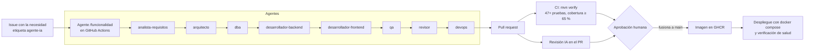

# Uso de la inteligencia artificial en el proyecto

Este documento cuenta, sin adornos, cómo se usó la IA para construir el proyecto, qué decidió la persona y qué hizo
la IA, cómo se verificó lo generado y cómo queda automatizado el proceso para las siguientes funcionalidades.

## 1. Resumen

| Fase | Quién decidió | Qué hizo la IA (Claude, como agente de Claude Code) | Cómo se verificó |
|---|---|---|---|
| Requisitos | El interesado: 16 decisiones de contexto (D-01 a D-16) y la aprobación final. | Redactó la versión 3 sobre la plantilla del curso, aplicó las decisiones, propuso valores por defecto marcados [PROPUESTA] y luego la versión final. | Revisión del interesado («Requisitos - Requerimientos están completos»). |
| Análisis y diseño | — | Casos de uso, modelo de dominio, secuencias y estados en Mermaid, a partir del código ya probado. | Cada endpoint, permiso y estado se contrastó con el código. |
| Arquitectura | — | Vistas C4, despliegue, flujo de entrega y 13 ADR. | Contraste con archivos reales (pom, compose, workflows). |
| Base de datos | Aprobó el modelo v1. | Modelo entidad-relación, 36 tablas, disparadores y funciones; luego migraciones Flyway. | Ejecución real en PostgreSQL 16 y 9 pruebas de reglas automáticas. |
| Backend | Pidió Java con Spring Boot. | 59 clases Java (unas 3.700 líneas) en 13 módulos de negocio. | Compilación, 47 pruebas automáticas, pruebas manuales por HTTP. |
| Frontend | — | Web instalable, 14 pantallas, cola sin internet; primero en JavaScript sin framework y luego migrada a React con íconos Font Awesome (ADR-015). | Prueba de humo en Chromium a 1280 y 390 px. |
| Pruebas | — | 47 pruebas (unitarias, reglas de base de datos e integración) y dos pruebas de interfaz en navegador. | `mvn verify` en verde, cobertura 71 %. |
| Despliegue | — | Dockerfile, docker-compose, CI/CD con GitHub Actions. | Imagen construida y pila levantada `healthy` con login real. |
| Automatización | Pidió «un agente que realice todo el proceso hasta llegar al despliegue». | `CLAUDE.md`, 8 agentes por rol, 3 comandos, un hook de protección y 2 flujos de GitHub con agentes. | El hook se probó (bloquea editar V1 y permite crear V3). Los flujos de GitHub se activan cuando el código esté en un repositorio. |

## 2. Cómo trabajó la IA en este proyecto

La IA no generó todo de una vez y lo entregó. Trabajó como un desarrollador con herramientas: leyó los documentos,
escribió archivos, **ejecutó** el código y las pruebas en un contenedor, leyó los errores y corrigió. Ese ciclo es lo
que hace confiable el resultado, y quedó registrado en estos errores reales que la propia verificación detectó:

| Error de la IA | Cómo se detectó | Corrección |
|---|---|---|
| La auditoría guardaba `registro_id` nulo en tablas con llave compuesta. | Prueba en PostgreSQL del modelo v1. | `coalesce` sobre id, uuid o la fila completa. |
| Las particiones mensuales se cortaban en hora UTC y no de Colombia. | Revisión de los límites generados. | Límites con zona `America/Bogota`. |
| Dos cambios de precio en la misma transacción violaban la vigencia del historial (`now()` no avanza dentro de una transacción). | Falló la migración de datos demo. | `clock_timestamp()` y verificación `>=`. |
| El driver de PostgreSQL estaba solo en tiempo de ejecución y el código lo usaba al compilar. | Error de compilación. | Alcance `compile`. |
| `Map.copyOf` falla con valores nulos en el detalle de compra. | Prueba manual del endpoint. | Se eliminó la copia. |
| Las pruebas asumían ids de referencia en orden de inserción. | Pruebas de humo fallidas. | Buscar por código de barras. |
| Los filtros de fecha de los reportes usaban la fecha UTC. | Revisión de la pantalla de inicio. | Zona de la sesión de base de datos en hora de Colombia. |
| `/actuator/metrics` quedaba público. | Revisión de seguridad al preparar el despliegue. | Solo `health` e `info` expuestos. |
| Las pantallas acumulaban manejadores de eventos al navegar. | Revisión del enrutador. | Contenedor nuevo en cada navegación. |
| La auditoría copiaba el hash de la contraseña y algunas escrituras de usuarios quedaban sin autor. | Un subagente revisor de arquitectura leyendo el código. | `fn_auditar` excluye la columna; el aspecto cubre controladores transaccionales; prueba nueva. |
| Varias pruebas nuevas fallaron en la primera ejecución (5 de 46). | `mvn verify`. | Ajuste de las pruebas (puntos de guardado en transacción, cuerpo válido para probar 403) sin debilitar lo que verifican. |

La lección práctica: **el código generado por IA se acepta por evidencia (pruebas que corren), no por apariencia.**

## 3. Buenas prácticas aplicadas

1. **La persona decide, la IA propone.** Todo valor que la IA eligió quedó marcado ([PROPUESTA], luego [ADOPTADO]) para que el interesado lo viera y pudiera cambiarlo.
2. **Contexto explícito y versionado.** `CLAUDE.md` le dice a cualquier agente cómo es el proyecto, qué comandos usar, las 9 reglas que no se negocian y la definición de terminado. Es el mismo archivo para la persona y para la IA.
3. **Roles con responsabilidad acotada.** Cada agente de `.claude/agents/` tiene una sola tarea y solo las herramientas que necesita (el revisor no puede editar).
4. **Prueba primero.** El agente de backend escribe la prueba de aceptación, la ve fallar y luego implementa; no puede desactivar pruebas para lograr verde.
5. **Barandas automáticas, no solo instrucciones.** Un hook impide editar migraciones ya versionadas; la configuración niega leer `.env`, forzar `git push` o borrar volúmenes; CI exige pruebas y cobertura.
6. **Humano en el circuito para lo irreversible.** El agente abre el PR pero no lo fusiona; el despliegue a producción pasa por el ambiente `produccion` de GitHub, que admite aprobación obligatoria.
7. **Sin secretos en el código.** Todo por variables de entorno; `.env` está en `.gitignore`.
8. **Trazabilidad.** Requisito → diseño → prueba ([05-pruebas.md](05-pruebas.md)) y cada decisión importante como ADR.
9. **Honestidad sobre los límites.** Lo que no se probó (carga, concurrencia real, despachador de integración) está escrito en [05-pruebas.md](05-pruebas.md).

## 4. El agente que lleva una funcionalidad hasta el despliegue

| Pieza | Archivo |
|---|---|
| Reglas del proyecto | `CLAUDE.md` |
| Roles | `.claude/agents/{analista-requisitos, arquitecto, dba, desarrollador-backend, desarrollador-frontend, qa, revisor, devops}.md` |
| Proceso completo | `.claude/commands/funcionalidad.md` (`/funcionalidad <necesidad>`) |
| Revisión y despliegue | `.claude/commands/revisar.md`, `.claude/commands/desplegar.md` |
| Barandas | `.claude/settings.json`, `.claude/hooks/proteger-migraciones.sh` |
| Agentes en GitHub | `.github/workflows/claude.yml` (asistente `@claude` y agente por etiqueta), `.github/workflows/revision-ia.yml` |
| Entrega continua | `.github/workflows/ci.yml` |

Para activarlo en GitHub: subir el repositorio, instalar la app de Claude (`/install-github-app` desde Claude Code),
crear el secreto `ANTHROPIC_API_KEY` y la etiqueta `agente-ia`.

## 5. Guion para la demostración

1. **Contexto (2 min).** Mostrar `CLAUDE.md` y un agente, por ejemplo `.claude/agents/revisor.md`: la IA trabaja con reglas escritas.
2. **La aplicación (3 min).** `docker compose up -d`, entrar como `vendedor1`, vender por código de barras (2990000000101 en libras), ver la factura con lote y garantía; entrar como `gerente1` y ver el kárdex y la auditoría con el usuario que vendió.
3. **Las reglas se cumplen (2 min).** Intentar vender más de lo disponible (la API responde 409) y mostrar `ReglasBaseDatosTest`.
4. **El agente construye una funcionalidad (5 min).** En local: `claude` y `/funcionalidad Permitir anular un documento de ingreso desde la pantalla de compras`. O en GitHub: crear el issue con la etiqueta `agente-ia` y mostrar el PR que abre el agente, la CI en verde y los comentarios de la revisión IA.
5. **Las barandas (1 min).** Pedirle al agente que edite `V1__esquema_inventario.sql` y ver que el hook lo bloquea.
6. **Cierre (1 min).** Esta sección y la tabla de errores de la sección 2: la IA acelera, la verificación da confianza y la persona decide.

## 6. Ejemplos de instrucciones usadas

* «Aplica estas decisiones de contexto y produce los requisitos v3 siguiendo la plantilla, y un modelo de datos.»
* «Requisitos completos: dame una versión final. Base de datos: estructúrala en base a lo existente en una versión final. Backend, frontend, pruebas y despliegue en Java con Spring Boot. Necesito buenas prácticas usando IA, algo como un agente que realice todo el proceso hasta el despliegue.»
* Dentro del proceso, la IA se dio a sí misma instrucciones verificables: «ejecuta `mvn verify` y no termines hasta que pase», «prueba las 14 pantallas en el navegador y falla si hay errores de consola».

## 7. Límites y responsabilidades

* La IA puede equivocarse con seguridad aparente; por eso nada se da por bueno sin una prueba que corra.
* Los datos de demostración, NIT y códigos de barras son ficticios.
* La factura electrónica DIAN, los sistemas externos concretos y el volumen real son datos de la empresa (pendientes de producción en [01-requisitos.md](01-requisitos.md)).
* La responsabilidad sobre lo que se despliega es de las personas que aprueban el PR.
